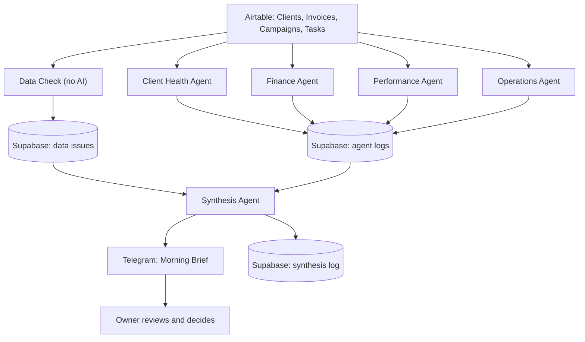

# Ruby AI CEO: An Early Warning System for a Marketing Agency

> One message every morning that tells the owner which clients need attention first, and how sure the system is about it.

Built by **Queen Ikwuji**, founder of [QueenEagleAI](https://queeneagleai-plum-iota.vercel.app)

**Built with:** n8n, Google Gemini, Airtable, Supabase and Telegram

---

Screenshot of the workflow:


## The problem

Most agency owners find out a client is unhappy too late.

The warning signs are usually there. The client goes quiet. An invoice is paid late. Ad results slip. Work runs behind. But each sign lives in a different tool, so nobody connects them until the client has already decided to leave.

## What this project does

This is an **AI chief of staff** for a UK marketing agency called Ruby Marketing Agency.

It is not a robot boss and it never makes decisions. Every weekday morning it checks the whole business, connects the dots between departments, and sends the owner one short, ranked list of what needs attention. It also says plainly what it is unsure about.

It is a team of seven parts, each with one job:

| Part | Its job |
|---|---|
| **Data Check** | Checks the data itself before anyone relies on it. Uses no AI. |
| **Client Health Agent** | Spots quiet clients and stalled deliverables |
| **Finance Agent** | Spots late, disputed and part paid invoices |
| **Performance Agent** | Spots ad campaigns where results are slipping |
| **Operations Agent** | Spots late tasks and uneven workloads |
| **Synthesis Agent** | Connects all the findings, ranks what matters and flags what is uncertain |
| **Failure Alert** | Messages the owner if any part of the system breaks |

They run in order each weekday morning: the Data Check first, then the four agents, then the Synthesis Agent, which sends the final brief.

## Sample output

This is an example of the morning brief. All names and numbers are fictional demo data.

```text
Ruby: Morning Brief

Two clients need attention today. One finding rests on data that needs checking.

Top priorities today:

1. 🔴 Finch and Hale Interiors: Quiet client, late invoice and overdue work
Invoice INV-1055 is 44 days overdue and contact stopped after it was sent.
A photo editing task is 12 days late and ad returns have fallen.
Action: Contact the client directly about the invoice, the late task and the campaign.
Based on: Finance (INV-1055), Client Health, Operations (Showroom photo edits), Performance (Showroom Leads)

2. 🟡 Northfield Builders: Invoice 14 days overdue (confidence: medium)
Only Finance has a finding for this client.
Action: Send a friendly payment reminder.
Based on: Finance (INV-1063)

Needs your input:
- Northfield Builders: Campaign figures look implausible. Spend went from 33 to 720 in one week.
  Question: Is that real, or are the numbers in the wrong columns?
```

The key idea is in priority 1. No single agent would call it an emergency on its own. Together, a silent client, a late invoice, late work and falling ad results add up to a real risk, and the owner sees that as one clear message.

## How it works



Each agent follows the same simple pattern: read the data, ask Gemini for a judgment using clear written rules, save the result, and pass it on. Because the pattern repeats, adding a new agent means adding one more input, not rebuilding the system.

Everything is saved to a database, so the system builds a memory of every client over time instead of starting from zero each day.

## Built to be trusted, not just clever

A system like this is only useful if the owner can trust it. These four rules are built in.

**1. Missing information is never treated as good news.**
If an agent did not run, could not read its own answer, or has no data for a client, the brief says so. It never says "no concerns" about something nobody checked.

**2. Disagreements are shown, not hidden.**
If the records contradict each other, for example one table says a client is on track while the task list shows work running late, the brief shows both sides instead of forcing a neat story.

**3. Every conclusion shows its evidence.**
Each priority lists the findings it is based on, and each of those can be traced back to a saved record. If the AI cites evidence that does not exist, the system catches it and lowers its confidence.

**4. When unsure, it asks a person.**
Unclear or doubtful items go into a "Needs your input" section as plain questions. Urgency is also recalculated in code from verified findings only, so questionable data can never raise a false alarm.

## Design decisions

- **The AI advises, the human decides.** It never contacts a client or changes anything. The rules forbid it from recommending legal action, ending contracts, discounts or ad budget changes.
- **Code does the maths, AI does the judgment.** Things like "17 days overdue" are calculated in code, because AI models are unreliable at date arithmetic.
- **Written rules, not guesswork.** Every agent has a clear low, medium and high scale, so the same data gives the same answer each time.
- **Separate parts, shared memory.** If one agent fails, the others keep working.
- **The system watches itself.** A failure alert messages the owner when something breaks, with the likely cause in plain English.

## What went wrong while building it

The unglamorous part is where most of the learning happened.

- **Every client showed as "Unknown".** The code looked for a field called Status but the spreadsheet column was called ClientStatus. One word made the whole agent blind.
- **The database rejected the second run.** A client name had been used as the unique key, so each client could only be saved once. History could not build up until this was fixed.
- **The same data scored differently on different runs.** Fixed by making the AI answer consistently.
- **A spend figure jumped by 23,233 percent.** The numbers had been typed into the wrong columns, and the AI reported them as a real emergency. This is exactly why the Data Check exists.
- **A broken AI answer was logged as "nothing flagged".** Now a failed run is reported as a failed run.

## Limitations

- It is a decision support tool. The AI can misjudge, so the owner reviews every brief.
- The demo uses fictional data. Real data should be tested and checked against the owner's own judgment before anyone relies on it.
- Data is entered into Airtable by hand for now. Live connections to ad platforms, project tools and accounting software are the next step.
- The Data Check can spot impossible numbers, but not numbers that are wrong and still believable.
- The evidence trail goes back to the saved finding, not yet to the original spreadsheet row.
- The free tier of Google Gemini is for testing. Real client data should go through a paid account.

## Roadmap

- [x] Client Health Agent
- [x] Finance Agent
- [x] Performance Agent
- [x] Operations Agent
- [x] Synthesis Agent with evidence and confidence
- [x] Data Check
- [x] Failure Alert
- [ ] Live data from ad platforms, project tools and accounting software
- [ ] Tap to reply buttons in Telegram for the questions it asks
- [ ] A watchdog that notices when a workflow never started
- [ ] Weekly trend report from the saved history
- [ ] Ask the CEO: chat with the system about any client

## About the author

I help businesses automate repetitive work with AI agents and workflows, and I teach people how to build practical AI automations themselves. My background is in HR recruitment and teaching, which shapes how I design systems: clear rules, human judgment where it matters, and explanations anyone can follow.

- Portfolio: [queeneagleai-plum-iota.vercel.app](https://queeneagleai-plum-iota.vercel.app)
- WhatsApp: +234 908 024 2840
- LinkedIn: [www.linkedin.com/in/queen-ikwuji-8b925524a](https://www.linkedin.com/in/queen-ikwuji)
- Book a Discovery Call: (https://calendly.com/queenikwuji/ai-workflow-discovery-call)

**Want something like this for your business?** Get in touch through my WhatsApp or LinkedIn DM


